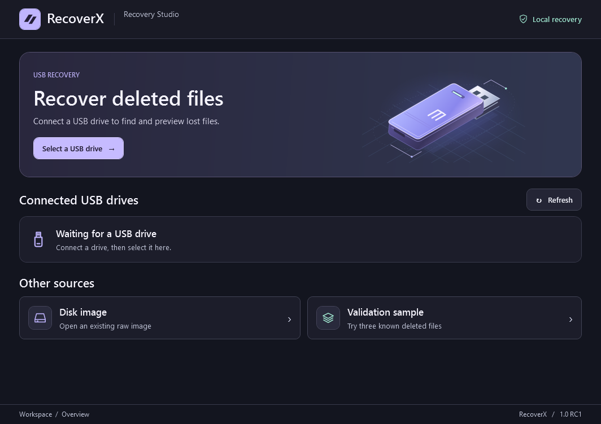
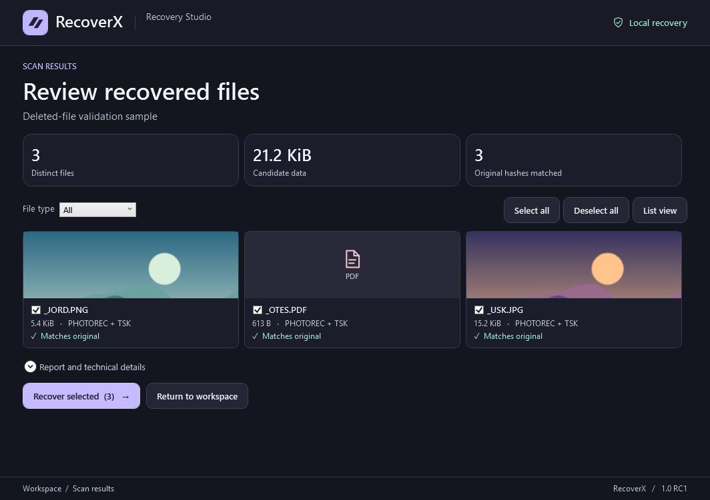
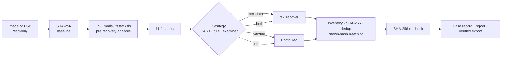

<div align="center">


# RecoverX

**Auditable deleted-file recovery for digital forensics — The Sleuth Kit and PhotoRec under one
evidence-preserving workflow, with an interpretable CART strategy recommender.**

[](https://github.com/A67med/RecoverX/actions/workflows/ci.yml)


-lightgrey)

</div>

RecoverX recovers deleted files from raw disk images and USB media by combining two
complementary techniques: **metadata-based recovery** with The Sleuth Kit (TSK), which follows
residual file-system records and keeps original names, and **signature-based carving** with
PhotoRec, which reconstructs files from content when metadata is gone. Every run is wrapped in
the controls an examiner needs: the evidence is hashed before and after, engines write to
isolated output folders, outputs are deduplicated by SHA-256 without deleting anything, and each
decision is written to an append-only case log.

RecoverX is also a research project. It asks whether a small decision tree, fed features that
TSK reports *before* recovery, can choose the right strategy per image. The evaluation data and
scripts are in [`research/`](research/).

<p align="center">
  
  
</p>

## Capabilities

| Area | What RecoverX does |
|---|---|
| Sources | Raw disk images (`.img`, `.dd`, `.raw`); USB drives on Windows through a read-only acquisition into a hashed case image (MBR, EBR, GPT, superfloppy; 512 B and 4Kn sectors). |
| Recovery strategies | **File records** (TSK `tsk_recover`), **Signature scan** (PhotoRec), **Both engines** (TSK then PhotoRec, merged by hash), **Smart** (CART recommendation with fallback), plus rule-v1 and CART-only for evaluation. |
| Evidence integrity | SHA-256 of the source before and after every run; a changed source marks the run `evidence_changed`; outputs never inside or over the evidence; no engine writes to the source. |
| Review & export | Gallery/list review, type filters, original-hash matching from a supplied manifest, structural validation of common formats, verified export with a receipt, PDF/JSON/CSV case reports. |
| Research | Controlled synthetic corpus generator with per-file ground truth, pre-specified labelling objective, CART training with grouped model selection, benchmark and statistics pipeline. |

Two front ends share one recovery core (`src/recoverx`):

* **Recovery Studio** — native Windows desktop (WPF, .NET Framework 4.8) with a bundled Python
  worker; runs offline without WSL or a system Python.
* **Web workspace** — cross-platform Streamlit interface (Linux, Kali, Windows with WSL for
  PhotoRec), including the research dashboard.

## How it works



**Metadata recovery vs. carving.** TSK restores complete files with names and paths when
directory entries survive (e.g., FAT deletions of contiguous files) but has nothing to follow on
ext4, where deletion clears extent pointers, or after a quick format. PhotoRec still works there
but loses names, struggles with fragmentation and produces candidates that need validation.
Running both maximises recall at extra cost.

**CART strategy selection.** The selector uses eleven features computed from TSK output before
any recovery (file system detected, FAT/ext family, partition table, image size, allocated and
deleted entry counts, deleted entries that still carry a size, reallocation flags). Training
labels are derived from measured runs: *the cheapest strategy whose exact-file recall is within
0.05 of the best* (objective frozen in [`config/objective.json`](config/objective.json)). A CART
tree (Gini impurity, depth and leaf size chosen on a validation split) maps the features to a
strategy, and every prediction is recorded with its decision path. The shipped model is a single
split — `n_deleted_named ≤ 4.5 → PhotoRec, otherwise TSK` — exported to JSON so the desktop needs
neither scikit-learn nor unpickling.

> **What the evaluation found.** On controlled FAT16/FAT32/ext4 images of 48 MiB–1 GiB, the CART
> selector recovered about as much as running both engines and more than the hand-written rule,
> but it was **not faster** than running both, because the metadata analysis it needs costs about as
> much as the work it avoids. The web workspace therefore treats the recommendation as advisory
> and runs both engines in automatic modes unless an examiner or researcher opts out.

## Requirements

| Use | Requirements |
|---|---|
| Recovery Studio (Windows) | Windows 10/11 x64, .NET Framework 4.8 (built in), about 170 MB installed, free space for the case image and recovered files. |
| Web workspace (Linux/Kali) | Python 3.11–3.13, `sleuthkit`, `testdisk` (PhotoRec). |
| Web workspace (Windows) | Python 3.12 x64; TSK is downloaded by setup; PhotoRec runs through WSL (Ubuntu with `testdisk`). |
| Research experiments | Linux with root (loop mounts), `mtools`, `dosfstools`, `e2fsprogs`. |

## Installation

### Recovery Studio (Windows desktop)

```powershell
git clone https://github.com/A67med/RecoverX.git
cd RecoverX
powershell -NoProfile -ExecutionPolicy Bypass -File .\scripts\windows\provision_desktop.ps1
.\RecoverX.exe
```

The provisioning script downloads CPython 3.12.7 (embeddable), pytsk3, The Sleuth Kit 4.15.0 and
TestDisk/PhotoRec 7.2 from their official publishers, **verifies each against a pinned SHA-256**,
and compiles `RecoverX.exe` with the .NET Framework compiler. To produce a portable ZIP and the
per-user installer:

```powershell
.\runtime\python.exe -B packaging\make_zip.py C:\build\RecoverX-Windows-x64.zip
powershell -NoProfile -File packaging\build-setup.ps1 -Archive C:\build\RecoverX-Windows-x64.zip -Destination C:\build\RecoverX-Setup-x64.exe
```

### Web workspace (Linux / Kali)

```bash
sudo apt install sleuthkit testdisk
python3 -m venv .venv && .venv/bin/pip install -e .
.venv/bin/python -m streamlit run app.py
```

`bash scripts/linux/install_desktop_entry.sh` adds a menu launcher. On Windows, the web workspace
is set up by `scripts\windows\setup_streamlit.cmd` and started with `scripts\windows\start_streamlit.cmd`
(see [`docs/WINDOWS_INSTALL.md`](docs/WINDOWS_INSTALL.md)).

## Usage

1. **Choose a source** — a connected USB drive (Windows desktop), an existing raw image, or the
   built-in *Validation sample* (three known deleted files).
2. **Choose a method** — Smart, File records (TSK), Signature scan (PhotoRec) or Both engines.
   Optionally load a manifest of original SHA-256 hashes.
3. **Confirm and start** — USB sources are first acquired read-only into a hashed `evidence.img`.
   Only the acquisition helper asks for elevation.
4. **Review** — filter, preview and select files; each row shows the engine(s) and whether the
   content matches a known original.
5. **Export** — copies are verified by hash; a receipt and the case report are written next to them.

Validate any desktop installation with the bundled checks (synthetic images only):

```powershell
.\runtime\python.exe -B validation\make_fixture.py
.\Run` validation.cmd
```

## Development

```bash
pip install -e ".[dev]"
python -m ruff check src scripts tests desktop validation research/experiments
python -m pytest -q          # real-engine tests run when tsk_recover/photorec are installed
```

CI runs the suite on Ubuntu (Python 3.11–3.13, real TSK/PhotoRec) and on Windows, where it also
provisions the desktop dependencies, builds `RecoverX.exe` and runs the engine validation checks.

## Scientific reproducibility

[`research/`](research/) contains the corpus manifests, the original benchmark (`results/exp1`),
and the scripts and records of the 2026-11 study (replication, 192 fresh images, scaling;
6,408 runs with per-run CPU and memory). `research/experiments/paper_2026_11/run_all.sh`
regenerates the synthetic images and reruns everything; the statistics scripts recompute the
reported numbers from the saved records. Re-running on the consolidated code reproduced the
recovery outcome of every image/strategy cell exactly.

## Project structure

```
src/recoverx/        recovery core: engines, forensic case store, ML selector, orchestrator,
                     USB acquisition (Windows), reporting, Streamlit UI, benchmarking
desktop/             Windows desktop scan worker (Python, runs in the embedded runtime)
native/              Recovery Studio WPF sources, build script, PhotoRec/pytsk3 build helpers
packaging/           ZIP packager and per-user installer
validation/          synthetic MBR/FAT32 fixture, engine checks, desktop GUI checks
scripts/             provisioning, launchers (windows/, linux/), training and benchmark CLIs
config/              pre-specified labelling objective
research/            datasets, models, experiments and results
docs/                architecture, methodology, installation, testing, releases, images
tests/               unit, integration and security tests
licenses/            third-party licence texts
```

## Third-party software

RecoverX runs **unmodified** The Sleuth Kit and PhotoRec as separate programs and uses CPython,
pytsk3, scikit-learn, NumPy, SciPy, pandas, Pillow, Streamlit, Plotly and ReportLab. No third-party
binaries are stored in this repository. See [`THIRD_PARTY_NOTICES.md`](THIRD_PARTY_NOTICES.md).

## License

RecoverX's own code is distributed under the terms in [`LICENSE`](LICENSE) (MIT, marked
provisional by the project team). The recovery tools keep their own licences (TSK: CPL/IBM/GPL
components; PhotoRec: GPL-2.0-or-later).

## Known limitations

* Physical USB acquisition on Windows is implemented but **has not yet been validated on real
  hardware**; the desktop checks use mock and file-backed sources. Software read-only access does
  not replace a hardware write-blocker.
* The evaluation uses synthetic, small FAT16/FAT32/ext4 images; NTFS, exFAT, SSD/TRIM and real
  casework media were not benchmarked. Treat the CART recommendation as advisory.
* TSK 4.x can stop with “Invalid address in run” on some deleted FAT32 entries whose recorded
  run extends past the volume; RecoverX reports such runs as failed with their partial output.
* The desktop and installer are unsigned. The official PhotoRec Windows build is started as
  invoker; a native MinGW build can be produced from source with `native/build_photorec.py`.
* RecoverX is not a validated forensic tool in the sense of NIST CFTT; verify results
  independently before relying on them.
