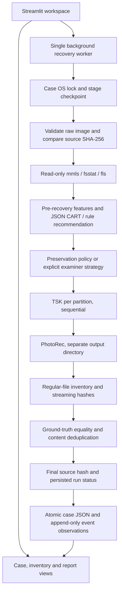

# Architecture (v0.2)

`recovery/orchestrator.py` owns the integrity boundary, strategy application and persisted lifecycle.
`engines/` adapts external tools; `process.py` uses argument lists, no stdin, bounded stdout/stderr readers,
timeouts and process-group cancellation. `forensic/` validates paths and stores cases.
`ml/` separates features, recommendations, JSON inference and measured evaluation.
`reporting/exports.py` produces inert metadata exports and neutralizes CSV formula prefixes.
`recovery/jobs.py` has no Streamlit calls; the UI observes its worker through a polling fragment.

Core interfaces are retained: `BaseEngine.run(...) -> EngineRun`,
`extract_features(FsAnalysis) -> dict`, `run_recovery(Case, method, ...) -> dict`.
New optional `cancel_event`, `progress` and `conservative` arguments preserve existing callers.
Case JSON retains old fields; additional settings, errors, warnings and accurate run timestamps are additive.

## Persistence and interruption

`cases/<id>/case.json` is replaced atomically after an fsync of a unique temporary file.
`.recovery.lock` uses POSIX advisory locking; stale lock files do not retain a lock after process exit.
`active_run.json` records the latest stage and completed engine inventories. Ordinary exceptions and
cancellations finalize the run; abrupt process/power loss may leave only the checkpoint.
No partial tool output is automatically reused. These are local filesystem records, not a transactional
database or cryptographically authenticated log. Only cooperating processes honor advisory locks.

## Resource model

Hashes use 1 MiB chunks. Each command retains at most 8 MiB per output stream while draining excess bytes;
truncation is recorded, and incomplete fls output cannot justify an ML single-engine choice.
Recovery engines run sequentially. Inventory and case metadata remain in memory proportional to the
number of recovered files; a database/index is deferred until large-corpus measurements justify it.

## Threat boundary

Linux/WSL, trusted local examiner, private workspace. Recovered files are not rendered or executed.
Symlink/FIFO/hardlink output entries are skipped; image/output overlap is rejected. External forensic
tools remain native parsers of untrusted data: use an isolated OS environment for hostile evidence.
JSON model digests detect accidental changes; they are not digital signatures or trust endorsements.
